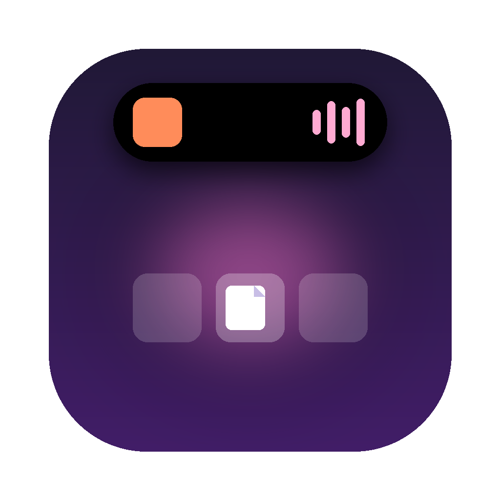
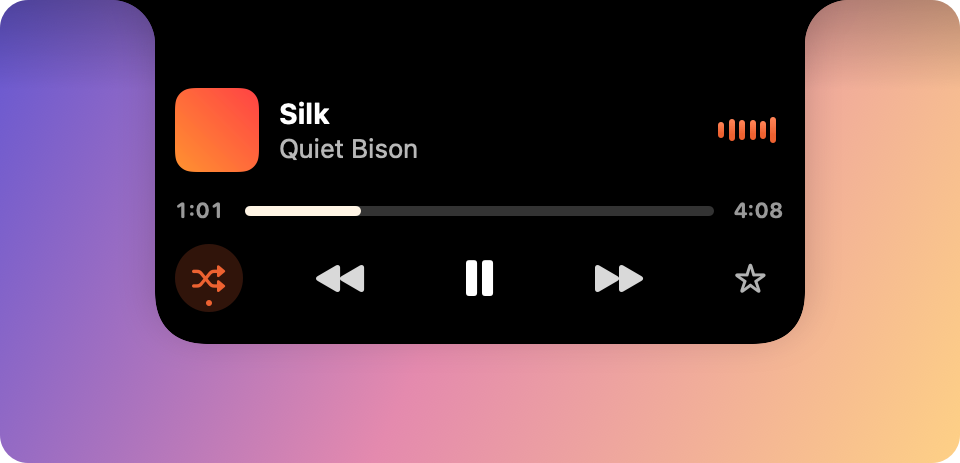
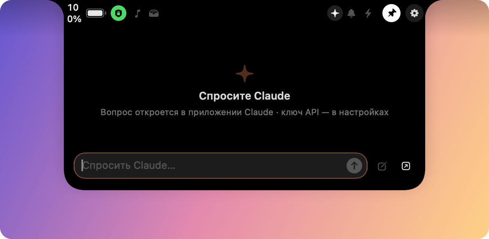
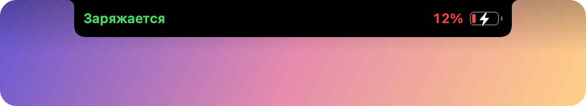
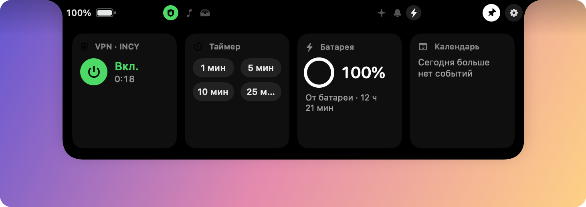
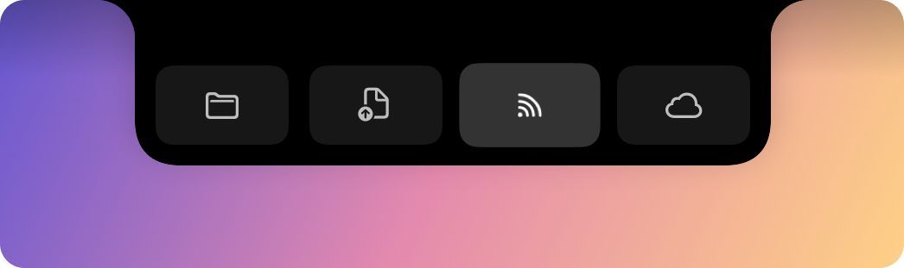
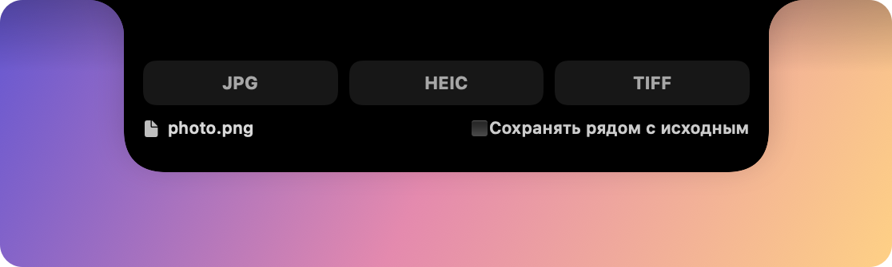

<div align="center">



# Da10bayo

**Dynamic Island для выреза MacBook**

Остров у выреза плавно «вытекает» из рамки экрана и показывает музыку, уведомления,
Claude, VPN и полку для файлов.




</div>

## Возможности

### 🎵 Медиаплеер
Яндекс Музыка, Spotify, Apple Music, браузеры и любые плееры с системным «Сейчас играет».

- В свёрнутом виде — обложка и эквалайзер в цвет обложки по бокам выреза.
- В раскрытом — обложка, название, визуализатор, перемотка, перемешивание, пауза, переключение треков, избранное (Apple Music).
- Свайп двумя пальцами влево/вправо по острову переключает трек.


### ✦ Claude
Вопрос прямо из острова. С ключом API ответ приходит потоком в остров (Claude Opus 5.5),
без ключа вопрос копируется и открывается приложение Claude.



### 🛡 VPN
Кнопка-щит в шапке острова и карточка во вкладке «Активности» включают и выключают VPN
(по умолчанию — INCY) одним нажатием через системную VPN-конфигурацию. При переключении
у выреза появляется полоса «INCY · Подключено».


### 🔔 Уведомления и live activities
- Уведомления Telegram и других приложений: баннеры Центра уведомлений и счётчики бейджей в Dock. Последние 30 — на вкладке «Уведомления».
- Подключение зарядки — полоса «Заряжается · 12%», предупреждение о низком заряде.
- Подключение AirPods и других Bluetooth-устройств.
- Напоминание о событии календаря за 5 минут.
- Таймер с обратным отсчётом прямо в вырезе.





### 📁 Полка, конвертер и отправка файлов
- Перетащите файл к вырезу — остров предложит: полка, конвертер, AirDrop, iCloud Drive.
- Конвертер: изображения (PNG, JPG, HEIC, TIFF), аудио (M4A, WAV, AIFF, CAF), видео (MP4, MOV, звук в M4A/WAV).
- С полки файл можно утащить обратно в любое место; полка сохраняется между перезапусками.




### ✨ Анимации
- Двухфазный «жидкий» морфинг, как на iPhone: при раскрытии остров сначала капает вниз из выреза, потом растекается в стороны; при закрытии — наоборот.
- Содержимое проявляется из размытия и не сплющивается во время анимации.
- Края острова плавно вытекают из рамки экрана.
- Работает и на Mac без выреза — там появляется «виртуальный» вырез.

## Установка

Нужно: macOS 14 Sonoma или новее и Xcode 15+ (или Command Line Tools со Swift 5.9+).

```bash
git clone https://github.com/dattenbayo/Da10bayo.git
cd Da10bayo
./build.sh --install   # соберёт, установит в /Applications и запустит
```

`./build.sh` без флага только соберёт `build/Da10bayo.app`. Проект открывается и в Xcode:
`File → Open…` → папка с `Package.swift`.

Если в Связке ключей есть сертификат «Apple Development», `build.sh` подпишет им
приложение — тогда разрешения macOS сохраняются между пересборками. Без сертификата
используется ad-hoc подпись, и «Универсальный доступ» после пересборки придётся выдать
заново (`tccutil reset Accessibility com.da10bayo.app`). Свой сертификат:
`SIGN_IDENTITY="…" ./build.sh`.

## Разрешения

| Разрешение | Зачем |
|---|---|
| Универсальный доступ | уведомления других приложений и бейджи Dock |
| Автоматизация → Spotify / Музыка | текущий трек и управление воспроизведением |
| Календари | ближайшее событие и напоминания |
| Bluetooth | уведомления о подключении устройств |

## Настройки

Иконка капсулы в строке меню → «Настройки…» (или шестерёнка в раскрытом острове):
поведение и жесты, размеры и скругления острова, доступ, активности и VPN, полка,
ключ API Claude, автозапуск при входе в систему.

## Ограничения

- macOS не отдаёт чужие уведомления сторонним программам, поэтому Da10bayo читает баннеры Центра уведомлений через Accessibility. Системный баннер при этом тоже показывается.
- Плееры, кроме Spotify и Apple Music, читаются через системное «Сейчас играет». С macOS 15.4 MediaRemote отвечает только процессам Apple, поэтому мост (`Helpers/MediaRemoteBridge.m`) загружается в системный `/usr/bin/perl`. Это неофициальный обход, и Apple может закрыть его в будущих версиях. Отключается в настройках: «Музыка → Все плееры».
- MP3 конвертер не создаёт: в macOS нет MP3-кодировщика.
- Экран блокировки пока не поддерживается.

## Структура

```
Sources/Da10bayo/
  App/        запуск, строка меню, связывание сервисов
  Notch/      окно над вырезом, модель состояний и морфинга, мышь/жесты/перетаскивание
  Views/      форма острова, плеер, баннеры, вкладки, полка, конвертер, Claude
  Services/   медиа, мост «Сейчас играет», уведомления, Claude, VPN, конвертер,
              батарея, Bluetooth, календарь, таймер, полка
  Settings/   настройки и окно настроек
Helpers/      мост MediaRemote (Objective-C) и загрузчик для perl
Resources/    Info.plist, иконка
docs/         скриншоты
```
